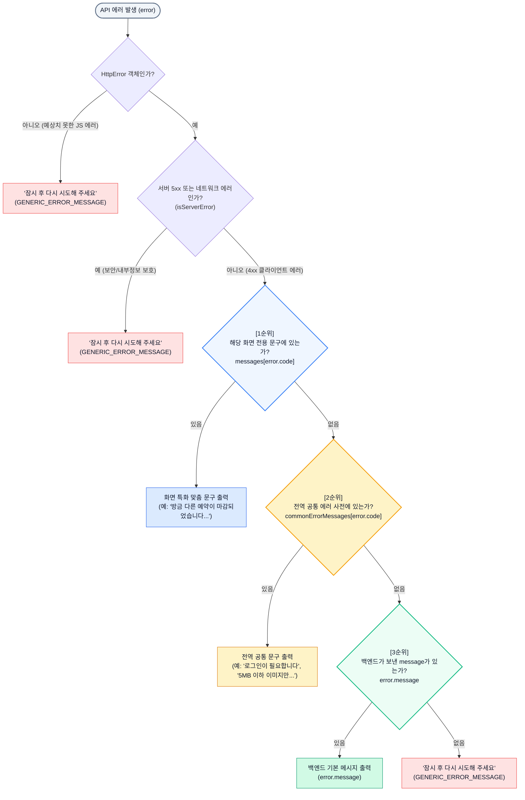

# 프론트엔드 에러 핸들링 아키텍처 및 메시지 처리 가이드

- **작성일자**: 2026-11-16
- **대상 프로젝트**: `preen-front-withAI`
- **핵심 모듈**: `src/common/utils/error.ts`, `src/common/api/client.ts`, 各 도메인별 `errorMessages.ts`

---

## 1. 개요: 프론트엔드 에러 재정의의 필요성

백엔드에서 `ApiResponse.error(code, message)` 형태로 에러 코드와 기본 메시지를 응답함에도 불구하고, 프론트엔드에서 `errorMessages.ts`와 `getErrorMessage` 함수를 통해 메시지를 단계별로 재정의하는 핵심 이유는 다음과 같습니다.

1. **사용자 행동 유도 (Actionable UX)**
   - 백엔드는 시스템/데이터 관점의 건조한 결과(예: `"재고 부족"`, `"인증 실패"`)를 전달하지만, 프론트엔드는 사용자가 **다음에 무엇을 해야 하는지**(예: `"방금 다른 예약이 마감되었습니다. 다른 날짜를 선택해 주세요."`) 화면 맥락에 맞추어 안내해야 합니다.
2. **보안 및 내부 정보 보호 (Security)**
   - 5xx 서버 내부 오류나 네트워크 에러 발생 시, DB 예외 스택 트레이스나 내부 시스템 식별자가 사용자에게 노출되는 것을 차단하고 안전한 범용 문구(`"잠시 후 다시 시도해 주세요"`)로 대체합니다.
3. **네트워크 장애 및 서버 미응답 대비 (Fallback Safety)**
   - 인터넷 단절, 타임아웃, 게이트웨이 오류(502/504) 발생 시 백엔드는 JSON 에러 메시지를 응답할 수 없으므로, 프론트엔드 자체의 안전망이 반드시 필요합니다.
4. **다국어(i18n) 및 톤앤매너 관리의 독립성**
   - 백엔드는 불변의 식별자(`code: "COMMON-002"`)만 보장하고, 클라이언트가 UI/디자인 톤앤매너나 사용자 로케일에 맞게 문구를 신속하게 변경할 수 있습니다.

---

## 2. 에러 메시지 결정 우선순위 (3단계 Fallback)

`getErrorMessage(error, messages)` 함수는 다음 3단계 우선순위에 따라 최종 사용자 메시지를 결정합니다.

```typescript
export function getErrorMessage(
  error: unknown,
  messages: Record<string, string> = {},
): string {
  if (!(error instanceof HttpError)) return GENERIC_ERROR_MESSAGE
  if (error.isServerError) return GENERIC_ERROR_MESSAGE

  return (
    messages[error.code] ??              // 1순위: 화면/도메인 특화 맞춤 문구
    commonErrorMessages[error.code] ??   // 2순위: 전역 공통 에러 사전 문구
    (error.message || GENERIC_ERROR_MESSAGE) // 3순위: 백엔드 원본 메시지
  )
}
```

### [1순위] 화면/도메인 특화 문구 (`messages[error.code]`)
- **정의 위치**: 각 기능별 컴포넌트 또는 도메인 파일 (`features/auth/errorMessages.ts`, `features/reservation/errorMessages.ts` 등)
- **목적**: 특정 화면의 폼이나 비즈니스 로직에 종속적인 고유 에러 안내
- **예시**:
  - `INVENTORY-001`: *"방금 다른 예약이 먼저 들어와 선택한 날짜가 마감되었습니다. 다른 객실이나 일정을 골라 주세요."*
  - `AUTH-012`: *"같은 이메일로 가입된 계정이 있습니다. 기존 계정으로 로그인한 뒤 마이페이지에서 소셜 계정을 연결해 주세요."*

### [2순위] 전역 공통 에러 사전 (`commonErrorMessages[error.code]`)
- **정의 위치**: `src/common/utils/error.ts`
- **목적**: 로그인 만료, 접근 권한, 파일 업로드 규격 등 **서비스 전체 어디에서나 공통으로 발생할 수 있는 에러**를 일관된 문구로 자동 처리
- **등록된 공통 코드**:
  - `COMMON-002`: *"로그인이 필요합니다."*
  - `COMMON-003`: *"접근 권한이 없습니다."*
  - `COMMON-004`: *"요청한 대상을 찾을 수 없습니다."*
  - `COMMON-006`: *"요청 크기가 허용 범위를 넘었습니다."*
  - `STORAGE-001`: *"비어 있는 파일은 올릴 수 없습니다."*
  - `STORAGE-002`: *"JPEG, PNG, GIF, WebP 이미지만 올릴 수 있습니다."*
  - `STORAGE-003`: *"5MB 이하의 이미지만 올릴 수 있습니다."*

### [3순위] 백엔드 원본 메시지 (`error.message`)
- **목적**: 프론트엔드에 별도로 커스텀 매핑이 정의되지 않은 일반적인 비즈니스 오류인 경우, 백엔드가 API 응답 body에 전달한 `message`를 그대로 화면에 출력합니다.
- 만약 `error.message`조차 비어있다면 최후의 보루로 `GENERIC_ERROR_MESSAGE`(*"잠시 후 다시 시도해 주세요"*)를 사용합니다.

---

## 3. 에러 판별 흐름도 (Mermaid Architecture)



---

## 4. 컴포넌트 적용 패턴 (Best Practice)

각 페이지 및 폼 컴포넌트에서는 `getErrorMessage` 함수에 해당 도메인의 에러 사전을 주입하여 사용합니다.

```tsx
import { getErrorMessage } from '@/common/utils/error'
import { reservationErrorMessages } from '@/features/reservation/errorMessages'
import { useToast } from '@/common/components/Toast'

function ReservationActionComponent() {
  const toast = useToast()

  const handleBooking = async () => {
    try {
      await api.createReservation(...)
    } catch (error) {
      // 1순위: reservationErrorMessages, 2순위: commonErrorMessages, 3순위: 백엔드 message
      const message = getErrorMessage(error, reservationErrorMessages)
      toast.show(message, 'error')
    }
  }
}
```

---
*본 가이드는 `preen-front-withAI` 프로젝트의 클라이언트 에러 처리 표준 규약 문서입니다.*
