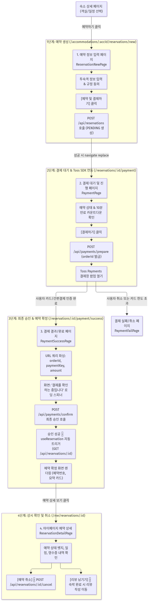
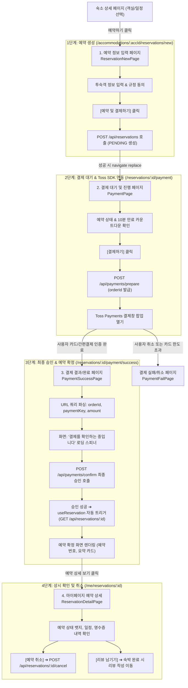
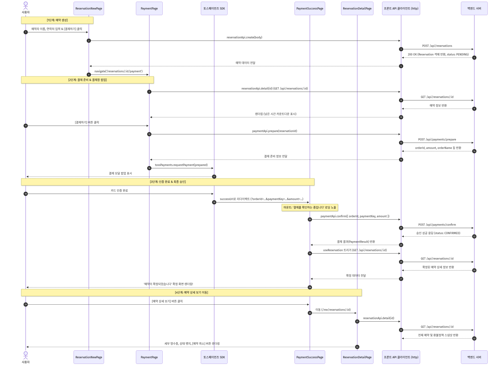
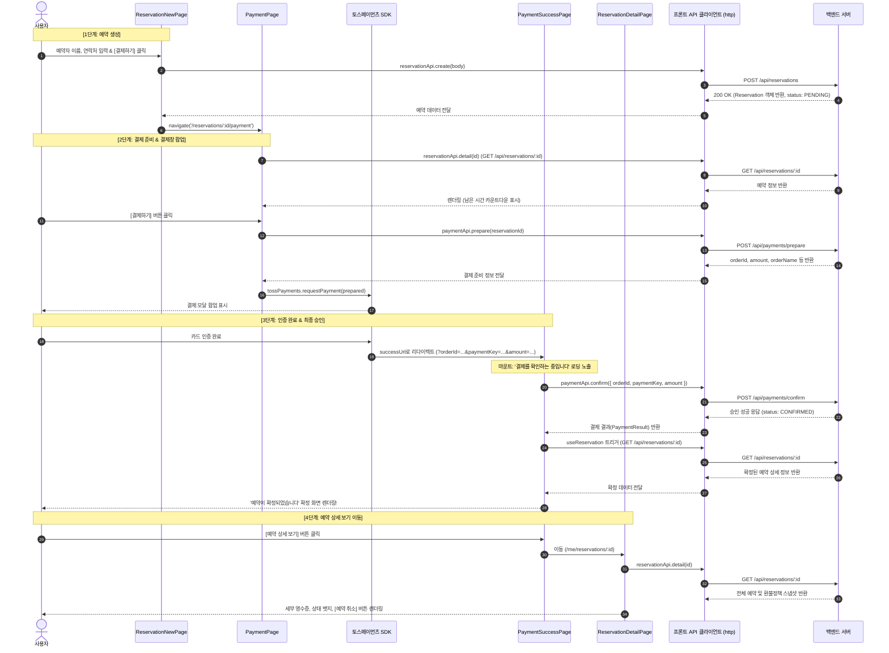

# 프론트엔드 예약 생성 ~ 결제 완료 전체 플로우 가이드

- **작성일자**: 2026-11-18
- **대상 프로젝트**: `preen-front-withAI`
- **핵심 모듈**: `ReservationNewPage`, `PaymentPage`, `PaymentSuccessPage`, `ReservationDetailPage`, `reservationApi`, `paymentApi`

본 문서는 숙소 상세 페이지에서 객실을 선택한 후 **예약 정보 입력(생성) ➔ 결제 준비 및 PG 결제창 호출 ➔ 결제 승인 및 예약 확정 ➔ 예약 상세 조회**로 이어지는 프론트엔드 전 과정의 플로우차트, 시퀀스 다이어그램, 컴포넌트, 훅, API 쿼리 구조를 총정리한 명세서입니다.

---

## 1. 전체 화면 전환 플로우차트 (Flowchart)

<b>Mermaid 다이어그램 소스 코드 펼치기</b>

---

## 2. 프론트엔드 종합 시퀀스 다이어그램 (Sequence Diagram)

<b>Mermaid 다이어그램 소스 코드 펼치기</b>

---

## 3. 페이지별 사용 컴포넌트, 훅, 쿼리/API 총정리

### 1) 예약 생성 페이지: `ReservationNewPage.tsx`
* **파일 위치**: `src/features/reservation/pages/ReservationNewPage.tsx`
* **URL**: `/accommodations/:accommodationId/reservations/new?roomId=...&checkIn=...&checkOut=...&guestCount=...`

| 구분 | 이름 | 역할 |
| :--- | :--- | :--- |
| **컴포넌트** | `<CheckoutLayout />` | 결제 단계 표시 헤더(Step 1)와 좌우 2열 분할 레이아웃 제공 |
| | `<StaySummaryCard />` | 우측 사이드바에 숙소 썸네일, 일정, 객실, 예상 금액 요약 표시 |
| | `<FormField />` | 예약자명, 휴대폰 번호 입력창 및 에러 메시지 래핑 |
| | `<RefundPolicyTable />` | 숙소의 취소/환불 규정 테이블 표시 |
| | `<LoadingBlock />` / `<ErrorState />` | 객실 및 숙소 데이터 페칭 중 로딩/에러 뷰 |
| **훅 (Hooks)** | `useAccommodationDetail(id)` | 숙소 이름 및 환불 정책 스냅샷 조회를 위한 쿼리 훅 |
| | `useAvailability(id, checkIn, checkOut)` | 실시간 객실 가용 여부 및 기간 총 요금 조회를 위한 쿼리 훅 |
| | `useSession()` | 로그인된 사용자 정보 자동 채우기용 세션 훅 |
| | `useInvalidateReservations()` | 예약 생성 성공 시 기존 목록 및 재고 캐시 무효화 훅 |
| | `useSearchParams()` / `useNavigate()` | URL 쿼리 파싱 및 결제 페이지 이동 네비게이션 |
| **API / 쿼리** | **`POST /api/reservations`** | `reservationApi.create(body)`: `PENDING` 상태 예약 생성 및 재고 선점 요청 |

---

### 2) 결제 진행 페이지: `PaymentPage.tsx`
* **파일 위치**: `src/features/payment/pages/PaymentPage.tsx`
* **URL**: `/reservations/:id/payment`

| 구분 | 이름 | 역할 |
| :--- | :--- | :--- |
| **컴포넌트** | `<CheckoutLayout />` | 결제 단계 표시 헤더(Step 2)와 결제 진행 화면 틀 제공 |
| | `<HoldCountdown />` | 결제 대기 유효 시간(10분) 카운트다운 타이머 바 표시 |
| | `<ReservationSummaryCard />` | 확정된 예약의 기본 정보와 총 결제 금액 요약 카드 |
| **훅 (Hooks)** | `useReservation(id)` | 결제 대상 예약 정보 조회 (`GET /api/reservations/:id`) |
| | `useHoldRemaining(data)` | 10분 만료까지 남은 시간(ms) 실시간 계산 |
| | `useParams()` | URL 경로에서 `reservationId` 추출 |
| **API / 쿼리** | **`POST /api/payments/prepare`** | `paymentApi.prepare(id)`: 백엔드 결제 준비 등록 및 `orderId` 발급 |
| | **토스페이먼츠 SDK** | `gatewayFor(pgProvider).requestPayment(...)`: 실제 토스 결제 팝업창 호출 |

---

### 3) 결제 완료/결과 페이지: `PaymentSuccessPage`
* **파일 위치**: `src/features/payment/pages/PaymentResultPages.tsx`
* **URL**: `/reservations/:id/payment/success?orderId=...&paymentKey=...&amount=...`

| 구분 | 이름 | 역할 |
| :--- | :--- | :--- |
| **컴포넌트** | `<CheckoutLayout />` | 결제 완료 단계(Step 3) 레이아웃 |
| | `<ReservationSummaryCard />` | 확정된 예약 데이터 최종 영수증 카드 렌더링 |
| | `<LoadingBlock />` | 백엔드 승인 및 예약 조회 중 "결제를 확인하는 중입니다" 전체 화면 로딩 |
| **훅 (Hooks)** | `useReservation(id)` | 결제 승인 완료 후 확정된 최신 예약 정보를 가져오는 쿼리 훅 |
| | `useInvalidateReservations()` | 승인 완료 후 기존 `detail` 및 `mine` 캐시 강제 무효화 |
| | `useSearchParams()` | 토스 리다이렉트 쿼리(`orderId`, `paymentKey`, `amount`) 파싱 |
| **API / 쿼리** | **`POST /api/payments/confirm`** | `paymentApi.confirm(...)`: 최종 PG 승인 및 예약 상태 `CONFIRMED` 전환 |
| | **`GET /api/reservations/:id`** | `useReservation(id)`: 승인 완료 직후 화면 갱신용 최신 예약 상세 조회 |

---

### 4) 마이페이지 예약 상세 페이지: `ReservationDetailPage.tsx`
* **파일 위치**: `src/features/reservation/pages/ReservationDetailPage.tsx`
* **URL**: `/me/reservations/:id`

| 구분 | 이름 | 역할 |
| :--- | :--- | :--- |
| **컴포넌트** | `<ReservationStatusBadge />` | 상단 타이틀 옆 예약 상태 뱃지(`예약 확정`, `결제 대기`, `숙박 완료` 등) |
| | `<PriceBreakdown />` | 객실료(박수), 인원 추가비 등 세부 요금 영수증 내역 표 |
| | `<RefundPolicyTable />` | 예약 시점에 박제되었던 취소 시점별 환불 규정 스냅샷 표 |
| | `<ConfirmDialog />` | [예약 취소] 버튼 클릭 시 열리는 취소 확인 모달 팝업 |
| **훅 (Hooks)** | `useReservation(id)` | 예약 상세 데이터 조회 (`staleTime: 0`) |
| | `useHoldRemaining(data)` | 만약 `PENDING` 상태일 경우 남은 결제 시간 계산 |
| | `useInvalidateReservations()` | 취소 완료 후 예약 목록 및 숙소 재고 캐시 파기 |
| | `useToast()` | 취소 완료/실패 시 화면 상단 토스트 알림 표시 |
| **API / 쿼리** | **`GET /api/reservations/:id`** | `reservationApi.detail(id)`: 예약 단건 전체 정보 조회 |
| | **`POST /api/reservations/:id/cancel`** | `reservationApi.cancel(id)`: 예약 취소 실행 및 환불/위약금 계산 결과 수신 |
